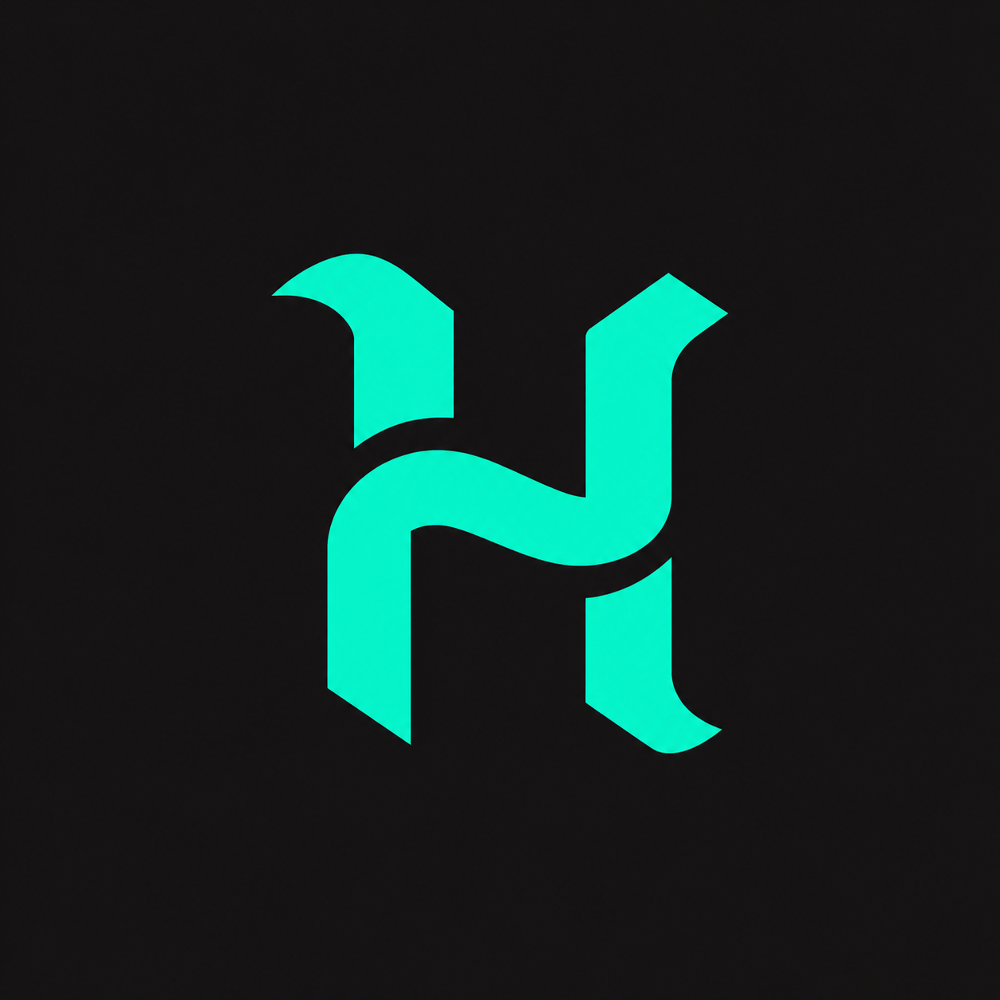

<div align="center">

<br>

<!--
  LOGO (optional): to show a logo, copy ONE  line from this comment and
  paste it below the comment (outside it). Replace ORG_HANDLE with your
  organization's GitHub handle (the name in its URL).

  Option A (easiest): uses the organization's profile picture.
  
  

  Option B: uses a file named logo.png uploaded inside the .github repo, in the profile folder.
  

  After pasting, add <br><br> under the  line so the logo has space below it.
-->


<h1>HERMANOS SOLUTIONS</h1>


<p>
Software, games, and interactive experiences,<br>
designed and built by developers and creatives<br>
who care how things work and how they feel.
</p>

<p>
  
  
  
  
  
</p>

<p>
  <sub>Overview &nbsp;&middot;&nbsp; Mechanics &nbsp;&middot;&nbsp; Gacha &nbsp;&middot;&nbsp; Design &nbsp;&middot;&nbsp; Optimization</sub>
</p>

<p>
  <a href="#about-us">About</a> &nbsp;&middot;&nbsp;
  <a href="#what-we-do">What We Do</a> &nbsp;&middot;&nbsp;
  <a href="#our-teams">Teams</a> &nbsp;&middot;&nbsp;
  <a href="#our-philosophy">Philosophy</a> &nbsp;&middot;&nbsp;
  <a href="#how-we-work">How We Work</a> &nbsp;&middot;&nbsp;
  <a href="#projects">Projects</a>
</p>

</div>

<br>

---

## About Us

HERMANOS SOLUTIONS is an independent group of developers and creatives who build together. We design, build, and maintain digital products and interactive experiences, and we care about how they work and how they feel to use.

We are not tied to a single technology, platform, or type of project. We follow good ideas, test them, and turn the ones that hold up into working products.

<br>

## What We Do

| Area | What it covers |
| :--- | :--- |
| **Software and tools** | Applications and digital tools built to be useful and easy to maintain. |
| **Web and backend** | Web development and the services that power it. |
| **Games and interactive experiences** | Game development and interactive projects. |
| **Roblox** | Roblox experiences and game systems. |
| **UI/UX and visual assets** | Interface design, visual identity, and the assets that go with them. |
| **Performance and quality** | Optimization and technical improvements to existing work. |

<br>

## Our Philosophy

| Principle | What it means for us |
| :--- | :--- |
| **Collaboration first** | We build together instead of working in isolation. |
| **Clear responsibilities** | Everyone knows what they own, and workflows stay organized. |
| **Maintainable code** | Code is structured so it can be understood, changed, and scaled. |
| **Shared standards** | Consistent conventions keep projects easy to move between. |
| **Always learning** | Every project is a chance to improve how we build. |
| **Quality and experience** | A good user experience matters as much as working features. |
| **Practical experimentation** | We try new ideas and keep what works. |

<br>

## How We Work

- **Collaboration.** Teams coordinate with each other, and the Overview team keeps direction and standards consistent.
- **Version control.** Our work lives in Git repositories on GitHub.
- **Code review.** Changes are reviewed by teammates before they are merged.
- **Issue tracking.** Tasks, bugs, and ideas are tracked as issues so nothing gets lost.
- **Organized development.** Clear ownership and shared standards keep projects moving in the same direction.

<br>

---

```

██╗  ██╗███████╗██████╗ ███╗   ███╗ █████╗ ███╗   ██╗ ██████╗ ███████╗     ██████╗ ██████╗    
██║  ██║██╔════╝██╔══██╗████╗ ████║██╔══██╗████╗  ██║██╔═══██╗██╔════╝    ██╔════╝██╔═══██╗   
███████║█████╗  ██████╔╝██╔████╔██║███████║██╔██╗ ██║██║   ██║███████╗    ██║     ██║   ██║   
██╔══██║██╔══╝  ██╔══██╗██║╚██╔╝██║██╔══██║██║╚██╗██║██║   ██║╚════██║    ██║     ██║   ██║   
██║  ██║███████╗██║  ██║██║ ╚═╝ ██║██║  ██║██║ ╚████║╚██████╔╝███████║    ╚██████╗╚██████╔╝██╗
╚═╝  ╚═╝╚══════╝╚═╝  ╚═╝╚═╝     ╚═╝╚═╝  ╚═╝╚═╝  ╚═══╝ ╚═════╝ ╚══════╝     ╚═════╝ ╚═════╝ ╚═╝

```

<div align="center">
  <i>© Hermanos 2026 - For Hermanos. By Hermanos</i>
</div>
